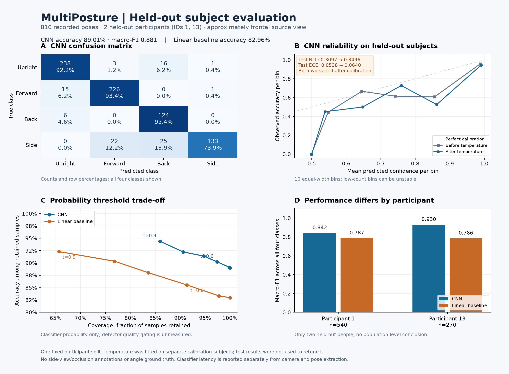

# Observed results on MultiPosture

The CNN achieved **89.01% accuracy and 0.8807 macro-F1** on 810 rows from two held-out participants. The baseline achieved 82.96% and 0.7916. These are results from one participant split in the approximately frontal acquisition domain, not side-camera validation or a clinical assessment.

**Temperature scaling did not transfer reliably to the test subjects.** CNN test NLL changed from 0.3097 to 0.3496, Brier from 0.1636 to 0.1692, and ECE from 0.05377 to 0.06405, although all three calibration-fit metrics improved. The original fitted temperature is retained; test results were not used to recalibrate, select a different checkpoint, or choose a threshold.

## Protocol and provenance

The exact downloaded CSV contained 4,794 rows and 13 participants. Participant groups are disjoint. Normalization is deterministic per pose; the baseline scaler is fit on training rows only. Validation selects the CNN epoch, separate calibration subjects fit one scalar temperature per model, and test subjects are evaluated after fitting.

| Split | Rows | Participant IDs |
| --- | --- | --- |
| train | 2694 | 12, 2, 3, 5, 6, 7, 9 |
| val | 750 | 10, 4 |
| calibration | 540 | 11, 8 |
| test | 810 | 1, 13 |

The CNN has 64,716 parameters. Best validation macro-F1 was 0.9128 at epoch 22; early stopping ended training after 34 epochs. Training plus scalar calibration and baseline fitting took 7.46 seconds on the recorded host. The seed was 42. Resolved settings, all class weights, hashes and selected epoch are saved in [train_summary.json](../artifacts/run/train_summary.json) and the checkpoint.

Cache SHA-256: `e76690b2b740572115cc4b51e72ad32cf5583dddd1a5de0caefa1915289c49fc`. Split SHA-256: `81ff5e6a257666027175dcc0e46b8e6bb081c188e3a10a98f25bf3c8a95f2b15`. These identify the exact prepared inputs, not an independent validation study.

## CNN versus the shallow baseline

| Held-out metric | CNN | StandardScaler + logistic regression |
| --- | --- | --- |
| Accuracy | 0.89012 | 0.82963 |
| Balanced accuracy | 0.88727 | 0.81028 |
| Macro-F1, four classes | 0.88066 | 0.79163 |
| Weighted F1 | 0.88976 | 0.81692 |
| NLL after temperature (lower is better) | 0.34955 | 0.41947 |
| Brier after temperature (lower is better) | 0.16923 | 0.24853 |
| ECE after temperature (lower is better) | 0.06405 | 0.06750 |

The CNN-minus-baseline difference is +6.05 percentage points in pooled accuracy and +0.0890 in macro-F1 on this split. This is a descriptive comparison; two test participants do not support a reliable statistical claim of superiority across users.

Macro-F1 averages all four class F1 values. Balanced accuracy averages recall of classes present; all four are present here. Multiclass Brier is the mean sum of squared probability errors over four classes (range 0–2). ECE uses 10 equal-width maximum-probability bins. Detailed definitions and reliability bin counts are in [evaluation_test.json](../artifacts/run/evaluation_test.json).

## Per-class errors and confusion

| Class | Support | CNN P | CNN R | CNN F1 | Baseline P | Baseline R | Baseline F1 |
| --- | --- | --- | --- | --- | --- | --- | --- |
| upright | 258 | 0.9189 | 0.9225 | 0.9207 | 0.8949 | 0.9574 | 0.9251 |
| leaning_forward | 242 | 0.9004 | 0.9339 | 0.9168 | 0.8647 | 0.9504 | 0.9055 |
| leaning_back | 130 | 0.7515 | 0.9538 | 0.8407 | 0.6158 | 0.9000 | 0.7312 |
| leaning_side | 180 | 0.9852 | 0.7389 | 0.8444 | 1.0000 | 0.4333 | 0.6047 |

The lowest CNN recall is `leaning_side`: 133 of 180 examples are correct, with 25 classified as `leaning_back`, 22 classified as `leaning_forward`. CNN backward precision is 0.7515, with recall 0.9538. Baseline side-class errors are 65 as `leaning_back`, 33 as `leaning_forward`, 4 as `upright`. Counts below use true classes on rows and predictions on columns.

### CNN

| True / predicted | Upright | Forward | Back | Side |
| --- | --- | --- | --- | --- |
| upright | 238 | 3 | 16 | 1 |
| leaning_forward | 15 | 226 | 0 | 1 |
| leaning_back | 6 | 0 | 124 | 0 |
| leaning_side | 0 | 22 | 25 | 133 |
### Logistic regression

| True / predicted | Upright | Forward | Back | Side |
| --- | --- | --- | --- | --- |
| upright | 247 | 3 | 8 | 0 |
| leaning_forward | 12 | 230 | 0 | 0 |
| leaning_back | 13 | 0 | 117 | 0 |
| leaning_side | 4 | 33 | 65 | 78 |

In these approximately frontal samples, upright-to-side confusion is 1 and side-to-upright confusion is 0. **This does not test the upright-versus-lateral ambiguity of a side camera.** Side-view samples and per-row view labels are unavailable, and lateral movement along a side camera's viewing direction is not reliably recoverable from that single image. No side-view confusion matrix can be reported from this CSV.

## Performance by held-out person

| Participant | Model | Rows | Accuracy | Macro-F1 | NLL | Brier | ECE |
| --- | --- | --- | --- | --- | --- | --- | --- |
| 1 | CNN | 540 | 86.85% | 0.8421 | 0.4012 | 0.1956 | 0.0854 |
| 1 | Baseline | 540 | 83.70% | 0.7873 | 0.4554 | 0.2564 | 0.0611 |
| 13 | CNN | 270 | 93.33% | 0.9305 | 0.2462 | 0.1165 | 0.0444 |
| 13 | Baseline | 270 | 81.48% | 0.7857 | 0.3475 | 0.2328 | 0.0929 |

Counts are participant 1: 540 rows, participant 13: 270 rows, so pooled row metrics weight participants in proportion to their row counts. The CNN macro-F1 varies from 0.8421 to 0.9305. Repeated or temporally nearby poses are not independent people; no frame-based confidence interval is presented as a population-level interval. More held-out participants and a prespecified subject-level cross-validation protocol are needed to assess uncertainty.

## Calibration before and after temperature scaling

CNN temperature: **0.819535**. Baseline temperature: **1.611504**. Both were fitted using participants 11, 8 only. Calibration-fit results are diagnostics of fitting, while test results assess transfer to new people.

| Data | Model | NLL before | NLL after | Brier before | Brier after | ECE before | ECE after |
| --- | --- | --- | --- | --- | --- | --- | --- |
| Calibration fit | CNN | 0.09631 | 0.09426 | 0.05600 | 0.05506 | 0.01387 | 0.00594 |
| Calibration fit | Baseline | 0.14672 | 0.12625 | 0.09455 | 0.08307 | 0.03918 | 0.03409 |
| Held-out test | CNN | 0.30969 | 0.34955 | 0.16357 | 0.16923 | 0.05377 | 0.06405 |
| Held-out test | Baseline | 0.54259 | 0.41947 | 0.26543 | 0.24853 | 0.10394 | 0.06750 |

NLL, Brier and ECE are lower-is-better. The fitted CNN temperature sharpens its probabilities. Inspect the reliability plot and its bin counts: small bins are unstable, and a good calibration-fit result does not guarantee improvement for new people. The baseline's fitted temperature improves all three test probability metrics on this split. Neither result establishes deployment calibration. Temperature does not change either model's argmax prediction or classification accuracy.

## Threshold coverage and abstention

| Probability threshold | CNN kept | CNN coverage | CNN accuracy kept | Baseline kept | Baseline coverage | Baseline accuracy kept |
| --- | --- | --- | --- | --- | --- | --- |
| 0.0 | 810 | 100.00% | 89.01% | 810 | 100.00% | 82.96% |
| 0.5 | 809 | 99.88% | 89.12% | 792 | 97.78% | 83.33% |
| 0.6 | 789 | 97.41% | 90.24% | 740 | 91.36% | 85.54% |
| 0.7 | 767 | 94.69% | 91.40% | 677 | 83.58% | 88.04% |
| 0.8 | 734 | 90.62% | 92.23% | 622 | 76.79% | 90.35% |
| 0.9 | 696 | 85.93% | 94.40% | 532 | 65.68% | 92.29% |

Illustrative CNN points: threshold 0.6: 789/810 rows retained (97.41%) at 90.24% accepted-sample accuracy; threshold 0.9: 696/810 rows retained (85.93%) at 94.40% accepted-sample accuracy. These points describe this fixed test set and are **not a test-tuned threshold recommendation**. Probability is not an individual guarantee of correctness. The CSV has no detector confidence, visibility or presence, so these numbers cannot estimate coverage after live pose-quality/occlusion gating. The live pipeline additionally abstains for unsupported views and missing or unreliable landmarks.

## Classifier-only latency

| Operation | Mean ms | Median ms | 95th percentile ms | Timed calls |
| --- | --- | --- | --- | --- |
| CNN forward pass | 0.4447 | 0.3796 | 0.7367 | 100 |
| Baseline scaler + decision function | 0.3667 | 0.3010 | 0.6154 | 100 |

Measurements used batch size 1, 20 warmup calls, and 100 timed calls. Inputs were prepared before timing. The CNN measurement excludes camera capture, MediaPipe, normalization, feature construction, transfer, softmax, smoothing and rendering; the baseline includes its scaler and linear decision function. **Do not invert these latencies to claim camera-to-result FPS.** A separate pipeline benchmark is required for end-to-end performance.

| Recorded environment | Value |
| --- | --- |
| Operating system | Windows-11-10.0.26200-SP0 |
| Processor identifier | Intel64 Family 6 Model 140 Stepping 1, GenuineIntel |
| Architecture | AMD64 |
| Device | cpu |
| PyTorch CPU threads | 2 |
| Python | 3.12.14 |
| PyTorch | 2.6.0+cpu |
| NumPy | 1.26.4 |
| scikit-learn | 1.6.1 |

The host reported a processor family identifier, not an exact retail CPU model. CPU measurements are sensitive to other workload and thread settings; they are not a deployment latency guarantee.

## Evidence limits

- This is one fixed split with only two test participants. Rows within a participant may be correlated; no external population test has been conducted.
- The source setup is approximately frontal, with no row-level view annotations. Side and oblique accuracy, and side-view upright/lateral confusion, are untested. The supplied classifier supports only the frontal source domain.
- Occlusion strata and real detector-confidence strata cannot be evaluated. Artificial joint dropout during training is not real-world occlusion validation.
- There are no ground-truth clinical angles or calibrated 3D measurements. Numeric measurement error, agreement with clinical reference measurements, and axis-specific physical accuracy are not established.
- Subject-independent pose-label accuracy does not validate ergonomic, medical, diagnostic or injury-risk conclusions. Projected image angles remain camera-dependent geometric summaries.
- Camera frames were not part of the supervised CSV. The classifier benchmark does not measure frozen MediaPipe extraction or a complete live pipeline.

Regenerate the figure and this report from the saved JSON using `python tools/make_report.py`. This reporting command never trains or tunes a model. See [TRAINING.md](TRAINING.md) for the method, [DATASET_AUDIT.md](DATASET_AUDIT.md) for source evidence, and the original machine-readable [evaluation_test.json](../artifacts/run/evaluation_test.json) for unrounded values.
